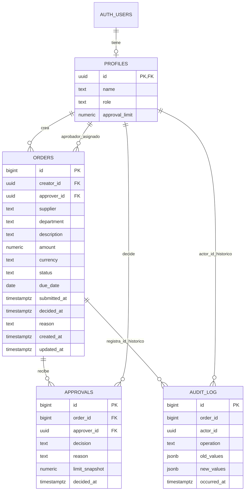

# Modelo de datos

audit_log conserva identificadores históricos sin FK para mantener la evidencia cuando se elimina un borrador. Las dos relaciones al log son lógicas. Cada usuario puede decidir una sola vez por orden. Los perfiles se provisionan de forma administrativa después de crear el usuario en Auth.
